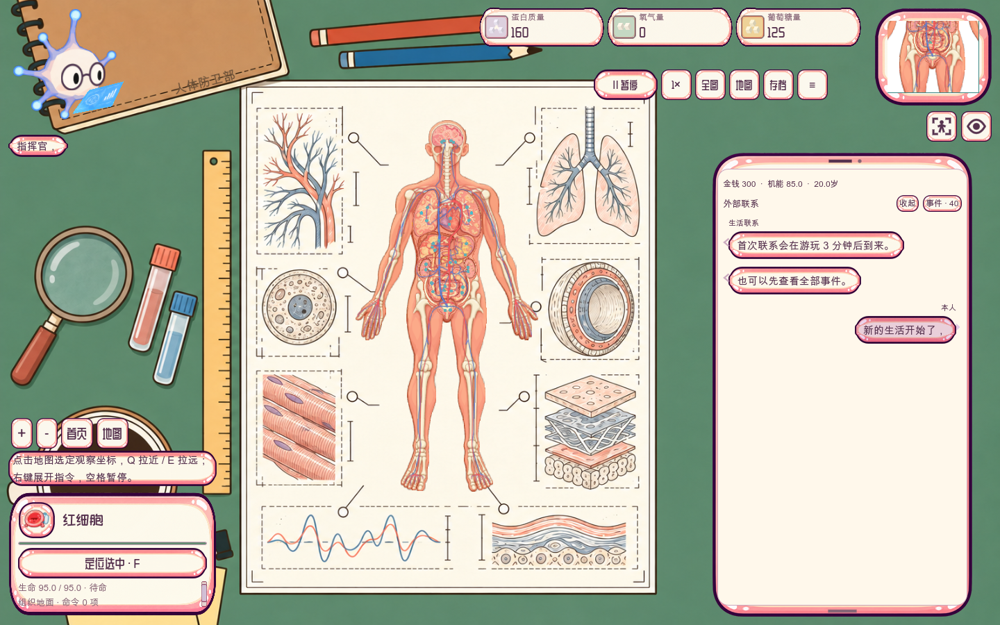
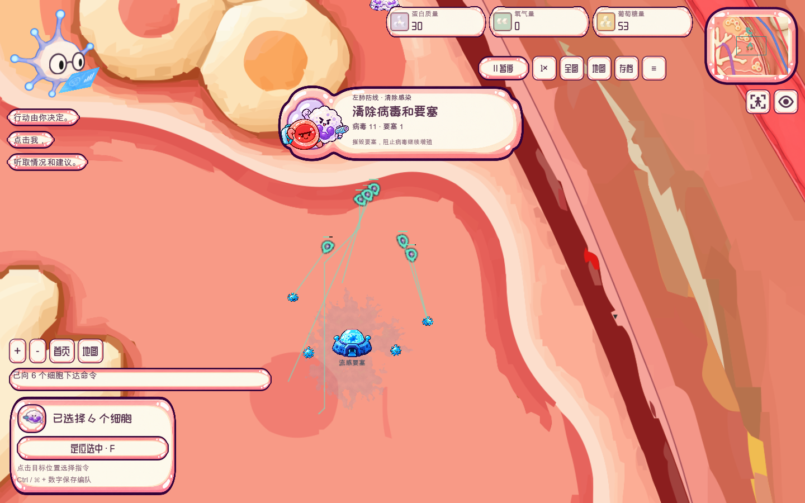
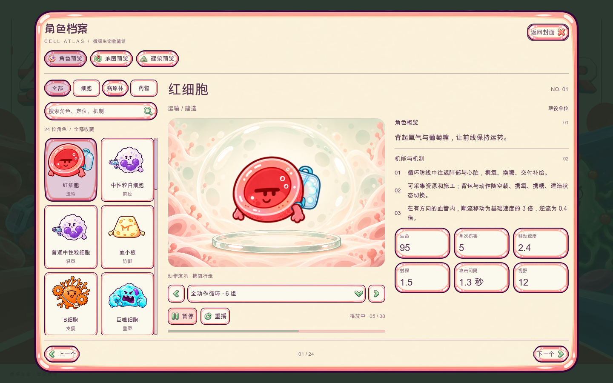
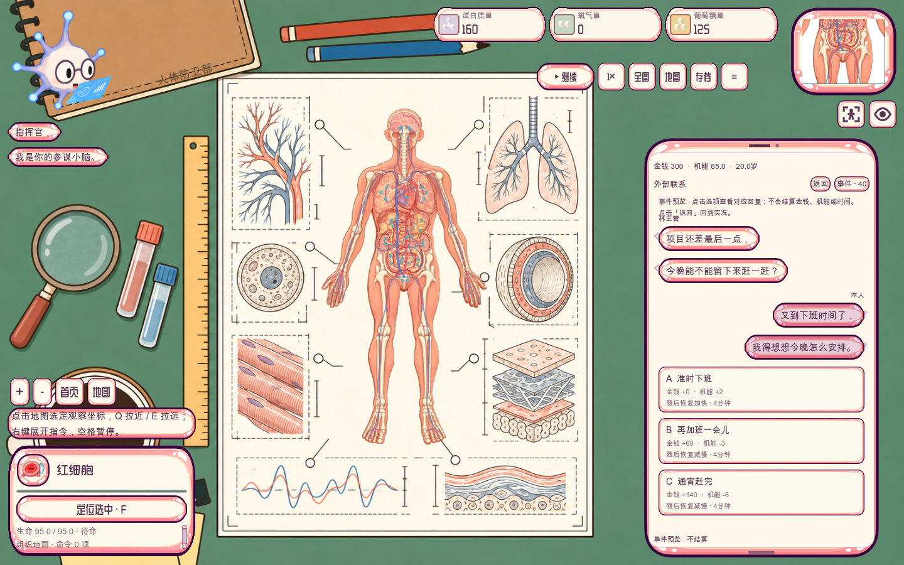

<div align="center">


# 细胞战争 · CELL WAR

**在一个身体里，守住整个世界。**

以人体为战场的单人生存即时战略游戏

<code>Godot 4.6+</code> · <code>GDScript</code> · <code>2D</code> · <code>离线游玩</code>

[走进细胞战争](#走进细胞战争) · [游戏画面](#游戏画面) · [开始体验](#开始体验) · [开发文档](docs/README.md)

</div>

你是「人体防卫部」的指挥官。

让背着氧气和葡萄糖的红细胞奔赴前线，为免疫细胞建立补给、训练与支援；
在器官与血管之间调度部队，阻止流感扩散，把被感染的组织一点点夺回来。
身体之外，工作、休息与生活选择也会影响体内的这场战斗。

## 走进细胞战争

### 从一条左肺防线开始

新局从左肺上部开始，拥有核心胞巢和 20 个红细胞。
利用 **120 秒准备时间**建设生产设施、训练白细胞；感染到来后，清除病毒和流感要塞，
再让红细胞与白细胞协作，连续净化感染区，夺回左肺。

建设、采集、训练、进攻与净化组成一场完整的首战。独立本地存档支持中途离开、继续作战。

### 一个身体，多种分工

| 探索人体 | 组织补给 | 指挥免疫防线 |
| --- | --- | --- |
| 从桌面上的全身人体图缩放到器官和局部组织，观察血管、关口与感染区。 | 红细胞采集、运输与交付资源，建设胞巢、生产设施和补给建筑。 | 训练与调度免疫细胞，结合侦察、支援和攻击能力组织防线。 |

血管有流向：顺流与逆流影响移动速度。地图中交叉的血管保持各自通行层，
不同器官、组织与血管共同构成需要规划路线的战场。

### 身体里的战局，也与生活有关

人体生存模式把生活安排与体内防卫连接起来。桌面手机带来工作、休息、进修等联系；
你的回复影响金钱、身体机能与持续状态，进而改变感染风险。
小脑顾问则在左上角陪伴指挥，提供情况汇报与建议。

角色档案收录 **24 个细胞、病原体与药物角色**，支持分类、搜索和动作预览；
生活模式提供 **40 个事件**。图鉴会标注现役单位、动作预览和原型，具体机制以各条目的说明为准。

## 游戏画面

以下均来自 **2026-10-24 版本的 Godot 桌面原生窗口**。点击图片可查看完整尺寸。

### 指挥桌面 · 将整个人体铺在面前

<a href="docs/showcase/command-desk.webp"></a>

研究图纸、文具与人体地图组成俯视指挥桌面；从全局观察到局部作战，保持同一套地图和镜头关系。

<table>
  <tr>
    <td width="50%" valign="top">
      <a href="docs/showcase/left-lung-battle.webp"></a>
      <p><strong>左肺防线 · 建设、训练与交战</strong><br>从正常开局回放中截取，展示部队进攻、资源与实时战斗目标。</p>
    </td>
    <td width="50%" valign="top">
      <a href="docs/showcase/cell-atlas.webp"></a>
      <p><strong>细胞档案 · 认识你的微观伙伴</strong><br>查看角色定位、动作与机制，奶油色面板和细胞膜边框延续角色画风。</p>
    </td>
  </tr>
  <tr>
    <td width="50%" valign="top">
      <a href="docs/showcase/life-decisions.webp"></a>
      <p><strong>生活决策 · 体外的一次选择</strong><br>工作与休息通过手机联系呈现；此图为游戏内只读事件预览。</p>
    </td>
    <td width="50%" valign="top">
      <a href="docs/showcase/map-atlas.webp"></a>
      <p><strong>人体地图 · 从全身认识战场</strong><br>预览全身、心脏、双肺与小肠，观察器官和血管的空间关系。</p>
    </td>
  </tr>
</table>

<sub>主海报保留真实开始页面。展示图仅做无损 WebP 编码；截图来源与版本记录见 <a href="docs/showcase/README.md">展示素材说明</a>。</sub>

## 开始体验

当前提供 Godot 工程源码。下载本仓库后，用 **Godot 4.6 或更新的标准版**导入
[`godot/project.godot`](godot/project.godot)，等待资源导入完成，按 **F5** 运行。

**建议第一站：**「开始作战」→「新建存档」→ 左肺防线。
「角色预览」可直接浏览角色、地图与建筑；更多模式从游戏中的「选择战场」进入。

macOS / Linux 也可从仓库根目录启动：

```sh
./godot/run.sh
```

| 操作 | 方式 |
| --- | --- |
| 选择细胞 | 左键点选或拖框；Shift 追加选择 / 命令 |
| 下达指令 | 右键打开目标处的指令菜单 |
| 观察战场 | 滚轮或触控板缩放，Q 拉近、E 拉远，放大后 WASD 平移 |
| 战术暂停 | 空格暂停 / 恢复，暂停时仍可安排命令 |

`godot/` 已包含运行所需的代码、场景、素材与数据，可离线运行。
Windows 可直接通过 Godot 项目管理器导入；macOS / Linux 可用 `./godot/run.sh --editor` 打开编辑器，或通过 `GODOT_BIN` 指定程序。

## 开发中的微观世界

当前版本使用原生 GDScript、Godot 场景与独立本地存档。
除左肺首战外，工程还包含人体生存、循环防线、呼吸道战役、三阵营沙盒和器官试验等入口；
各模式的完成度和验证范围见 [运行与开发指南](godot/README.md)。

整套玩法、原版一致性、手机真机与发行包仍在持续验证，旧版云存档尚未迁移。
已完成的检查与已知差异保留在 [PARITY.md](godot/PARITY.md)。

| 继续了解 | 内容 |
| --- | --- |
| [游戏运行与开发](godot/README.md) | 模式、操作、工程结构与专项验证 |
| [开发文档导航](docs/README.md) | 设计、素材与历史资料入口 |
| [更新记录](CHANGELOG.md) | 当前 Godot 工程进展与旧版历史 |
| [`godot/`](godot/) | 游戏代码、场景、运行资源与测试 |
| [`scripts/`](scripts/) | 离线素材制作、校验与动画工具 |

美术原稿、动画帧和制作记录在本机保留；仓库中的 [`assets/`](assets/) 为已纳入版本管理的部分。

<details>
<summary>开发与基础验证</summary>

```sh
./godot/run.sh --headless --editor --import --quit
./godot/run.sh --headless --script res://tests/run_tests.gd
python3 scripts/godot_tools/audit_integrity.py
```

更多专项检查见 [运行与测试说明](godot/README.md#验证与复现)。提交前运行
`python3 scripts/qa/check_repository_hygiene.py` 检查暂存区。
生成缓存、批量测试截图和本机配置保留在本机；`docs/showcase/` 仅收录用于作品介绍的精选展示图。

</details>
