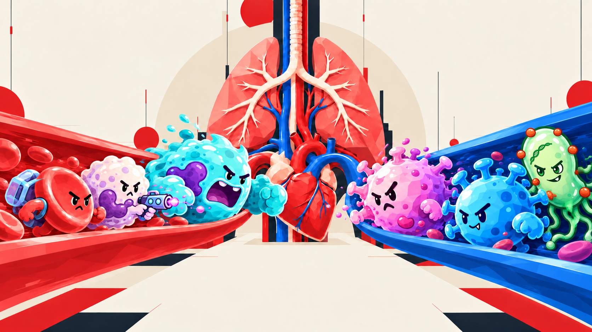

<div align="center">

# 细胞战争 · CELL WAR

**在一个身体里，守住整个世界。**

巨人体内的单人生存即时战略游戏

Godot 4.6+ · GDScript · 2D

[开始运行](#开始运行) · [开发文档](docs/README.md) · [当前进度](godot/PARITY.md)



<sub>游戏内置封面插画 · 角色与人体构成的微观战场</sub>

</div>

《细胞战争》把器官、血管与细胞组成一个可以探索和指挥的世界。
调度红细胞运输资源，组织免疫细胞守住关口，在不断扩散的感染中维持身体运转。

## 一个身体，多种战局

| 战略地图 | 细胞分工 | 生存与防线 |
| --- | --- | --- |
| 在全身与器官之间缩放观察，沿血管组织运输、调援和关口争夺。 | 红细胞采集与交付，免疫细胞参与作战；不同角色拥有各自的动作与定位。 | 进入人体生存、循环防线、呼吸道战役或三阵营沙盒，探索各模式的资源与作战规则。 |

血管具有方向，顺流与逆流影响行进速度；投影中的交叉保持各自通行层。
器官、血管、地形与游戏对象采用独立图层，让全身布局与局部交战共享同一张地图。

游戏内的**角色预览**可以浏览细胞、病原体、药物角色与地图。
已接入的机制和仅供预览的内容分别标注；模式与操作说明见 [Godot 开发指南](godot/README.md)。

## 开始运行

安装 **Godot 4.6 或更新的标准版**，导入 [`godot/project.godot`](godot/project.godot)，
等待资源导入后按 **F5**。

macOS / Linux 也可在仓库根目录执行：

```sh
./godot/run.sh
```

使用 `./godot/run.sh --editor` 打开编辑器；也可通过 `GODOT_BIN` 指定本机 Godot 程序。
Windows 可直接在 Godot 项目管理器中导入。

`godot/` 包含运行所需的代码、场景、素材和数据。游戏可离线运行，无需额外的语言运行时或素材制作工具。

## 开发状态

当前为持续开发的可运行版本，使用原生 GDScript 与 Godot 场景。
存档保存在本机；旧版云存档尚未迁移。完整玩法回放、原版一致性、手机真机与发行包仍有待验收。
已完成的检查和具体差异记录在 [PARITY.md](godot/PARITY.md)。

## 阅读源码

| 入口 | 内容 |
| --- | --- |
| [`godot/`](godot/) | 游戏代码、场景、运行资源与回归测试 |
| [`assets/`](assets/) | 美术原稿、动画帧与制作记录；根目录 ZIP 保留角色动画原始交付 |
| [`scripts/`](scripts/) | Godot 离线制作、素材校验与序列帧工具 |
| [文档导航](docs/README.md) | 开发说明、素材来源、设计资料与历史归档 |
| [更新记录](CHANGELOG.md) | 当前工程进展与明确标注的旧版历史 |

基础验证在仓库根目录执行：

```sh
./godot/run.sh --headless --editor --import --quit
./godot/run.sh --headless --script res://tests/run_tests.gd
python3 scripts/godot_tools/audit_integrity.py
```

更多专项检查见 [运行与测试说明](godot/README.md#验证与复现)。
提交前运行 `python3 scripts/qa/check_repository_hygiene.py` 检查暂存区；
缓存、测试截图、本机配置与批量预览保留在本机。
